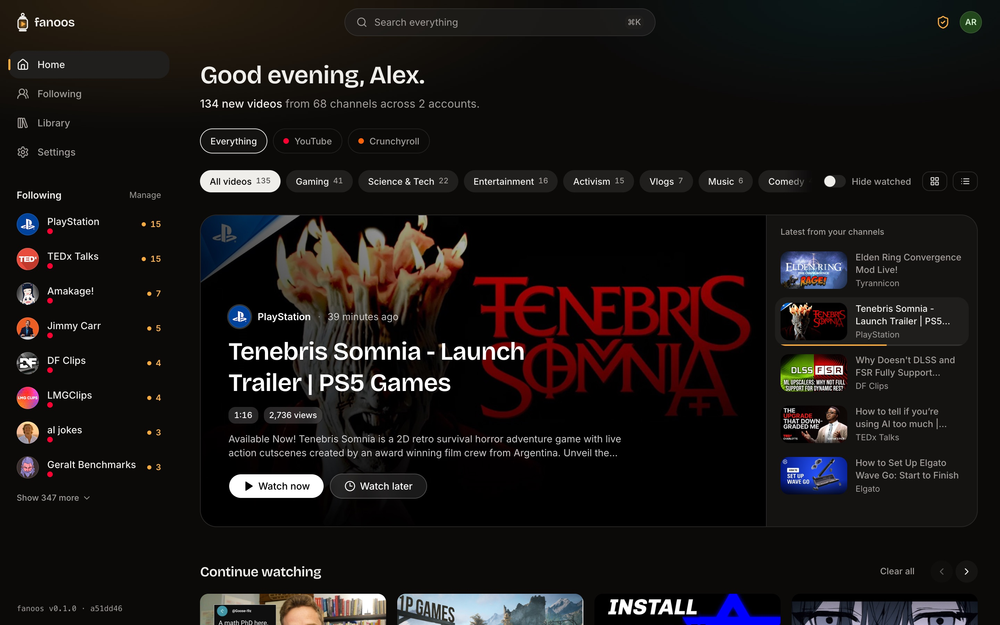
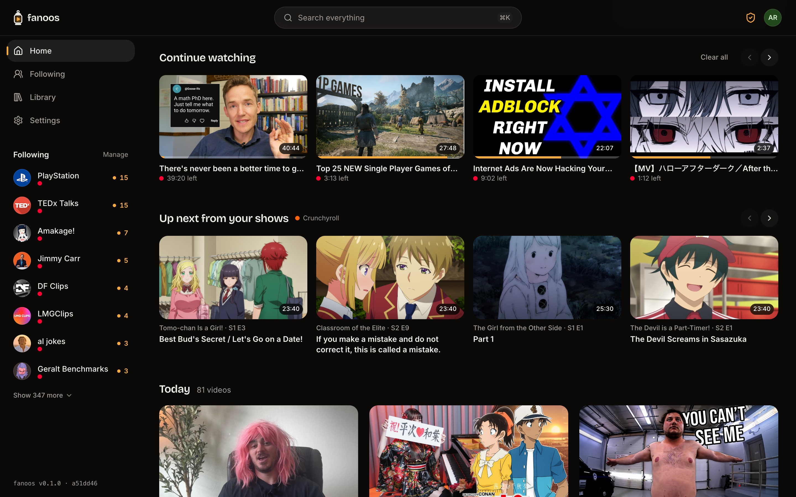
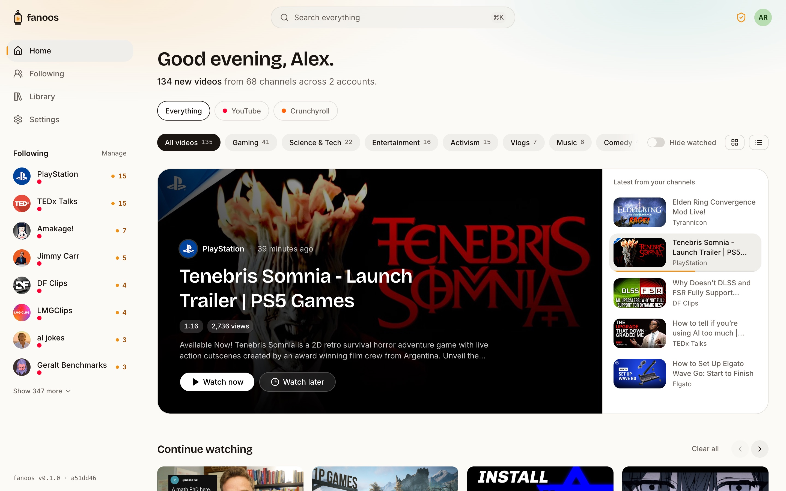
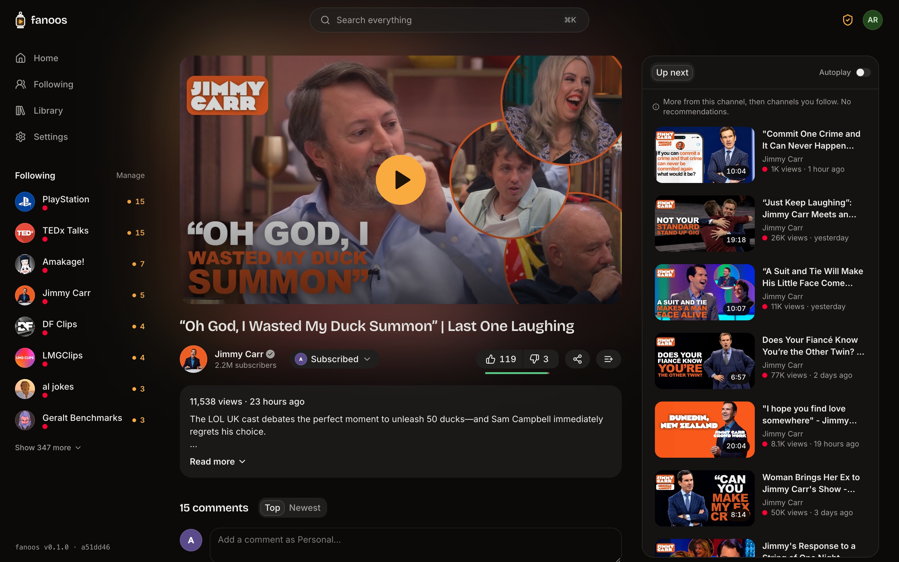
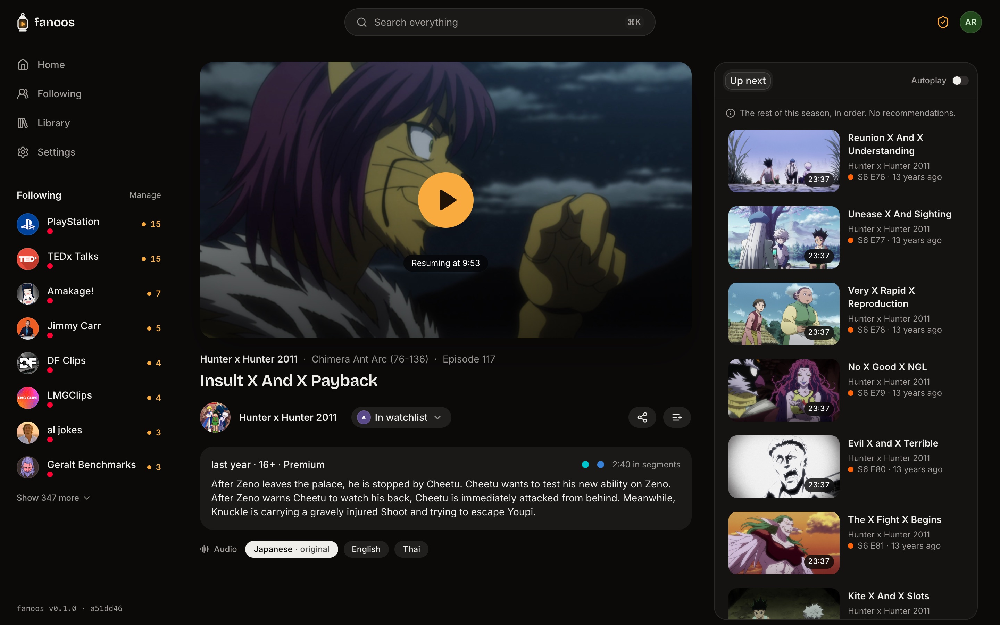
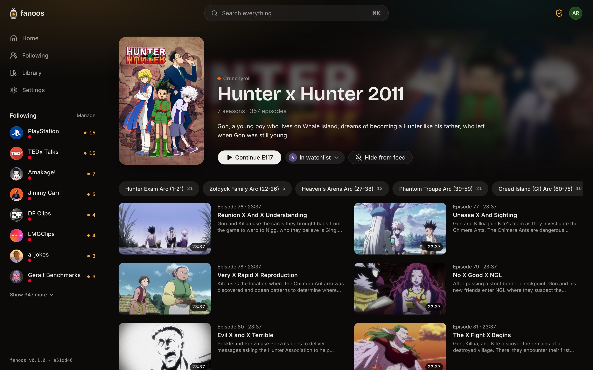
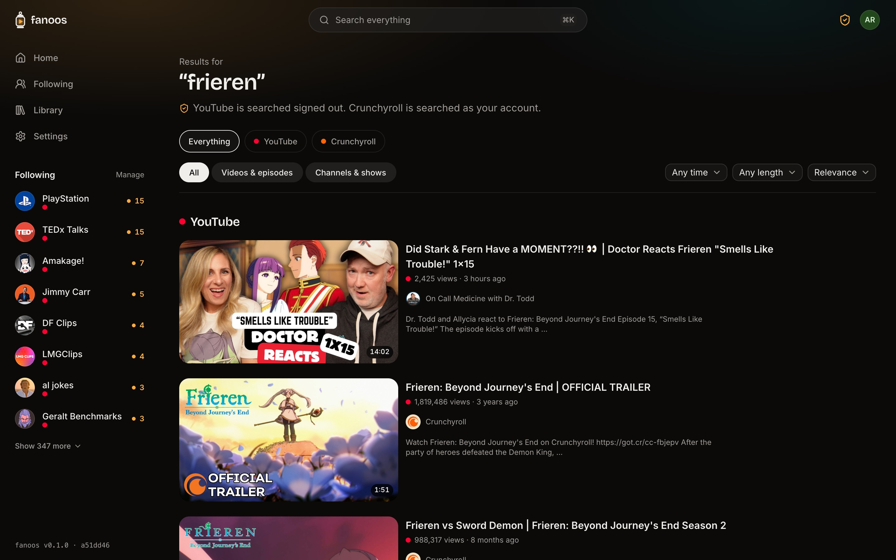
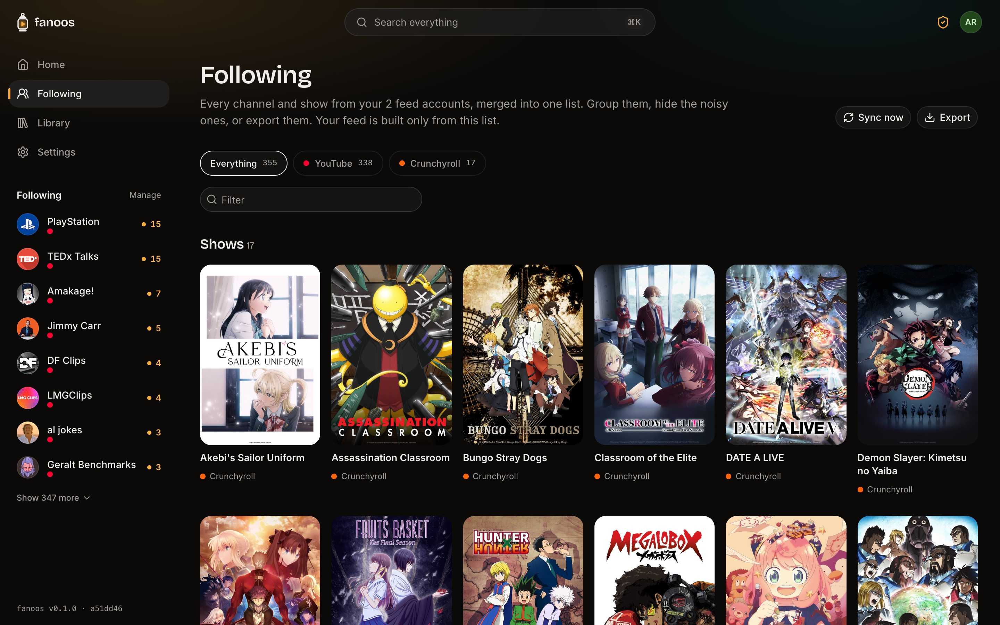
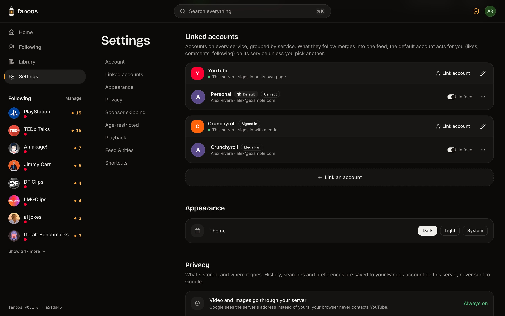

<p align="center">
  <picture>
    <source media="(prefers-color-scheme: dark)" srcset="docs/assets/logo-dark.svg">
    
  </picture>
</p>

<h1 align="center">Fanoos</h1>

<p align="center">One feed for YouTube and Crunchyroll. No recommendations, no ads, no tracking. Self-hosted.</p>



*Fanoos* (فانوس) is Persian/Urdu for "lantern". *Fanoos-e-khayal*, the "lantern of imagination", was the revolving magic lantern that cast moving pictures before cinema.

A self-hosted video client that puts several services in one place: your YouTube subscriptions and your Crunchyroll watchlist in a single feed, with no recommendations, no ads and no tracking. YouTube is watched signed out through your own server; Crunchyroll (which only works signed in) plays its DRM-protected streams in your own browser.

## Screenshots

| | |
|---|---|
|  |  |
| **Home:** Continue watching across services, and up next from your shows | **Light mode** |
|  |  |
| **YouTube:** SponsorBlock, dislikes, comments, no recommendations | **Crunchyroll:** DRM playback, subtitles, every dub, intro skipping |
|  |  |
| **Shows** with seasons and episodes | **Search** across every service |
|  |  |
| **Following:** channels and shows, grouped and hideable | **Linked accounts** on every service |

## Model

- **Fanoos account:** your own sign-in (passkeys, password, or single sign-on). It holds everything below and syncs it across devices: history, positions, Watch later, preferences.
- **Backend:** a separate service that talks to one provider: `services/youtube`, `services/crunchyroll`, `services/plex`. Fanoos core talks to every backend through one generic [provider protocol](packages/shared/src/protocol.ts) and has no provider-specific code.
- **Linked account:** an account on a provider, linked through its backend. A Fanoos account can hold many, across services. The backend keeps the credentials; core keeps only an opaque reference.
- **The merged feed:** what every linked account follows (YouTube subscriptions, Crunchyroll watchlists) merged into one feed, with each item marked with the accounts it came through.
- **Actions:** liking, commenting and following act as the default account on that service; the follow control and comment box let you pick another.

## Running it

```sh
git submodule update --init
npm install
cp apps/server/.env.example apps/server/.env
cp services/youtube/.env.example services/youtube/.env
cp services/crunchyroll/.env.example services/crunchyroll/.env   # optional
cp services/plex/.env.example services/plex/.env               # Plex servers and shared libraries
npm run dev
```

`npm run dev` starts Redis (:6379), the streaming companion (:8282), the YouTube backend (:8788), the Crunchyroll backend (:8789), the Plex backend (:8790), Fanoos core (:8787) and the web app (:5180). Open **http://localhost:5180** (not 127.0.0.1: passkeys need a hostname) and create an account. The first account is the server's owner.

Needs Node 24+, [Deno](https://deno.com) (`brew install deno`) for the streaming companion, and Redis (`brew install redis`).

Core and every backend share one secret, `BACKEND_TOKEN`: set the same random value in core and each enabled backend’s `.env` file (`openssl rand -base64 32`). Core finds the backends through `BACKENDS` (`slug=url` pairs; the slug appears in app URLs, e.g. `/watch/youtube/<id>`).

## Docker

Each release publishes four images for `linux/amd64` and `linux/arm64`: `ghcr.io/hcx-labs/fanoos-core` (which also serves the web app), `fanoos-youtube`, `fanoos-crunchyroll` and `fanoos-plex`. To run everything, with the streaming companion and Redis:

```sh
cp compose.env.example .env   # fill in BACKEND_TOKEN, COMPANION_SECRET, Google OAuth…
docker compose up -d
```

**Blocked by YouTube?** On many VPS and data-centre addresses, YouTube refuses the companion's anti-bot token: videos never start, and `docker compose logs companion` shows "Failed to validate PO token". Resolve through [Control D](https://controld.com) instead: [`compose.ctrld.yaml`](compose.ctrld.yaml) adds a `ctrld` container at a fixed address, and every service uses it as its DNS server. In your Control D profile, redirect YouTube's domains (youtube.com, googlevideo.com, ytimg.com, ggpht.com, googleapis.com) to a proxy location, then:

```sh
cp ctrld/ctrld.toml.example ctrld/ctrld.toml   # put your resolver ID in it
docker compose down                            # once: the network gets a fixed subnet
echo 'COMPOSE_FILE=compose.yaml:compose.ctrld.yaml' >> .env
docker compose up -d
```

To use a different DNS setup per backend (say, Crunchyroll through another Control D profile), add a second ctrld instance with its own config and address and point only that backend at it; `compose.ctrld.yaml` shows how. HTTP proxies work too: `COMPANION_PROXY` for the companions, `YOUTUBE_PROXY` for the backend's own requests. See Invidious' [notes on blocked IPs](https://docs.invidious.io/youtube-errors-explained/) for more.

Then open `PUBLIC_URL` (default http://localhost:8787). Only core is published on a port; everything else stays on the internal network. Data lives in the `core-data`, `youtube-data`, `crunchyroll-data` and `plex-data` volumes. Signed-in playback for age-restricted videos (optional, owner only) runs as its own container: `docker compose --profile age-restricted up -d companion-signed-in`, then sign in with the google.com/device code shown in Settings → Signed-in playback. The sign-in is kept across restarts in the `companion-signed-in-session` volume.

### Releases

Actions → **Release** → Run workflow, and pick **patch**, **minor** or **major**. The workflow bumps the version in every package, commits and tags it, builds and pushes the three images, and publishes a GitHub release listing them.

## Layout

npm workspaces:

- `apps/web`: the React app (Vite, Tailwind v4, shadcn kit components in `src/components/ui/`).
- `apps/server`: **Fanoos core** (Hono on Node 24+, runs TypeScript directly; SQLite via `node:sqlite`). Accounts and sessions, the linked-account registry, app data, merging across backends, and a proxy to backends' public routes (`/api/b/<slug>/public/…`).
- `services/youtube`, `services/crunchyroll`, `services/plex`: **backends**, one process each, each with its own database for credentials.
- `services/kit`: what every backend is built on (the protocol server, shared Redis cache, signing). Imported by relative path, since Node won't run TypeScript from `node_modules`.
- `packages/shared`: types shared by everything, including the provider protocol. Types only.
- `vendor/invidious-companion`: pinned submodule, YouTube streaming.

### The provider protocol

JSON over HTTP under `/v1`, authenticated with `BACKEND_TOKEN`: `info` (name, features, how linking works, link hosts), linking (redirect or device-code flows, polled by core), `following`, `feed`, `continue`, `search`, `videos`, `channels` (with sections, for seasons), `resolve` (pasted links), and actions (`follow`, `rating`, `comments`, `progress`). Browser-facing URLs (images, manifests, licences) are `/public/…` paths that core rewrites and proxies. A backend lists only the features it supports, and the app shows only those. See [`protocol.ts`](packages/shared/src/protocol.ts); adding a service means writing a backend, not changing core or the app.

## YouTube backend

- **Linking:** Google OAuth with PKCE, scope `youtube.readonly`, plus `youtube.force-ssl` only if you allow actions. Refresh tokens are encrypted (AES-256-GCM); unlinking revokes access at Google.
- **Feed:** each account's subscription list from the Data API (refreshed every 6 hours); new videos from each channel's public RSS feed (no quota), falling back to the channel's videos tab when RSS fails. Shorts are dropped; durations, views and categories come from one batched Data API call per 50 videos.
- **Everything else:** video pages, comments, channels and search through YouTube.js, signed out. SponsorBlock, Return YouTube Dislike and DeArrow (queried by hash prefix).
- **Playback:** [Invidious companion](https://github.com/iv-org/invidious-companion) generates YouTube's anti-bot tokens and streams media; the backend builds a multi-codec DASH manifest (H.264, VP9, AV1) and the player picks what the device decodes in hardware. `COMPANION_SECRET` must be exactly 16 characters.
- **Privacy:** every thumbnail, avatar and segment goes through signed proxy URLs. The browser never contacts Google.
- **Age-restricted videos (optional, owner only):** Settings → Age-restricted starts a second, signed-in companion used only for those videos. Use a secondary Google account.

### Google OAuth setup

1. In [Google Cloud Console](https://console.cloud.google.com/), create a project and enable **YouTube Data API v3**.
2. **Google Auth Platform → Branding:** app name and support email. **Audience:** External, and add every Google account you'll link as a test user. **Data access:** add `youtube.readonly` (and `youtube.force-ssl` for actions).
3. **Clients → Create client → Web application.** JavaScript origin `http://localhost:5180`; redirect URI `http://localhost:5180/api/b/youtube/public/oauth/callback`.
4. Put the client ID and secret, and a `YOUTUBE_API_KEY`, in `services/youtube/.env`.

While the Google app is in "Testing", only listed test users can link, and refresh tokens expire after 7 days (the app then shows **Link again**).

## Crunchyroll backend

Optional, and needs a **Crunchyroll Premium** account.

- **Unofficial.** Crunchyroll has no public API. The backend uses the client credentials of Crunchyroll's Android TV app, which you supply in `services/crunchyroll/.env` (`CRUNCHYROLL_BASIC_AUTH`, `CRUNCHYROLL_APP_VERSION`; community-maintained at [crunchy-labs/artifacts](https://github.com/crunchy-labs/artifacts)). Using it is against Crunchyroll's terms and can get an account restricted; use it with your own account at your own risk.
- **Linking:** the TV activation code. Fanoos shows a code, you enter it at crunchyroll.com/activate, and Fanoos never sees your password.
- **Not private:** browsing and playback happen as your account, so Crunchyroll sees what you watch there and keeps it in your history (Fanoos also reports your position, so its Continue Watching stays in sync). YouTube stays signed out regardless.
- **Playback:** Widevine DRM, end to end. The backend asks Crunchyroll for a playback session, proxies the manifest and segments, and forwards the browser's licence requests with your session attached. Decryption happens only in the browser's own CDM; Fanoos never sees or extracts keys. Works in Chrome, Edge and Firefox; Safari needs FairPlay, which isn't offered. Sessions count toward your plan's stream limit, are kept alive while playing, and are released when you leave.
- **Extras:** styled `.ass` subtitles (rendered with JASSUB), every dub as a seamless audio switch, intro and credits skipping, shows with seasons, and your watchlist as follows in the feed.

## Plex

Plex runs as its own provider service at `http://127.0.0.1:8790`. Add
`plex=http://127.0.0.1:8790` to core's `BACKENDS`, copy `services/plex/.env.example`
to `.env`, and use the same `BACKEND_TOKEN` as core. `npm run dev` starts it alongside
the other backends; `npm run dev --workspace @fanoos/plex` starts it separately.
No Plex developer secret is required.

In Settings → Accounts → Connect account, choose Plex and sign in on Plex's page.
The service discovers owned and shared Plex Media Servers, chooses a reachable
advertised connection, and uses each server's own access token. Account tokens are
encrypted in the backend database and never sent to the web app. Set
`PLEX_OWNED_ONLY=1` to omit shared servers. Unlinking removes the backend's stored
credentials; the authorization can also be revoked in Plex's Authorized Devices.

- Libraries appear under Following. TV libraries open into poster grids of shows,
  seasons, and episodes. Movie libraries appear in the dedicated Movies section.
- Selecting Plex on Home reveals the same compact filter pills as YouTube, populated
  from accessible server libraries. Recent additions populate Home; Plex resume positions populate Continue watching.
  Search covers accessible servers, movies, shows and episodes.
- Channels, Shows and Movies have their own navigation entries. The sidebar shows
  sources relevant to the current section; Sources retains account/group management.
- Original quality reads the original media file without transcoding. Browser codec
  and container support still apply. Common H.264/AAC MP4 files default to original.
- Quality transcodes request H.264 DASH at the selected resolution and bitrate.
  Audio stays original until Audio → Transcode is chosen; that option requests AAC
  stereo and lets Plex decide whether video conversion is needed. These use the
  Plex server's transcoder; playback requirements and
  server permissions still apply. Quality changes retain the playback position.
- Signed media URLs proxy artwork, file byte ranges, DASH manifests/segments, and
  text subtitles through Fanoos. Plex credentials and private server URLs stay on
  the backend. Intro/credit markers and chapters use the existing player controls.
- Plex Home managed-user switching, music, live TV and Plex's free streaming catalog
  are outside this integration. Image-based subtitles use Plex burn-in.
- Plex feed curation, date groups and newest-first browsing use release dates,
  never library added dates. Missing release dates remain unknown.
- Plex library listings, metadata and browse pages use the shared Redis-backed
  cache (two minutes, five minutes and one minute respectively), scoped by server
  and account credentials. Playback details and continue-watching bypass it; signed
  playback URLs and sessions are generated fresh. Artwork uses the same shared
  Redis cache for one day, with stable daily URLs and a one-day browser cache.
  Sync now refreshes library discovery and the visible browse page.
- Embedded text subtitles use Plex's native subtitle-only endpoint after media
  decision negotiation. Plex returns ASS for Fanoos's existing renderer; external
  subtitles use Plex's stream endpoint. No media-file scan or backend FFmpeg is
  involved, and subtitle requests do not change audio/video quality or saved track
  preferences. Subtitle text uses the shared Redis cache for seven days. Image
  subtitles retain the explicit Plex burn-in option.

The backend must be able to reach each Plex server from its own network (including
from inside Docker). HTTPS certificates remain verified. Direct-play media must be
supported by the viewer's browser; use a Transcode option otherwise.

Validation: `npm run test --workspace @fanoos/plex`, `npm run typecheck`, and
`npm run build`. The web interaction check is
`scripts/performance/plex-library.mjs`; `scripts/performance/catalog-layout.mjs`
checks responsive three-row pagination, sticky section pills and loading/error states.
`scripts/performance/feed-release-date.mjs` checks release-based feed curation.
Both use the existing isolated headless-Chrome
CDP harness. Plex's authentication reference is at
https://forums.plex.tv/t/authenticating-with-plex/609370 and the PMS API reference
is at https://developer.plex.tv/pms/.

## Fanoos core

- **Accounts:** passkeys (WebAuthn) or passwords (scrypt). Sessions use an HttpOnly, SameSite=Lax cookie; every write is checked against the app's Origin.
- **Caching:** the backends share one Redis (`npm run redis`: memory-only, 256 MB, least-recently-used eviction), each under its own key prefix. Responses are fresh for `CACHE_TTL_SECONDS` (default 600) and served stale while refreshing for up to `CACHE_STALE_SECONDS`. Failures are never cached. Without `REDIS_URL`, a bounded in-memory cache is used.

### Single sign-on (OIDC)

Set `OIDC_ISSUER`, `OIDC_CLIENT_ID` and `OIDC_CLIENT_SECRET` (optionally `OIDC_SCOPES`, and `OIDC_NAME` for the button label) in `apps/server/.env`, and register `${PUBLIC_URL}/api/auth/oidc/callback` with your provider (Authentik, Keycloak, Authelia…). When OIDC is on:

- Sign-in shows only "Continue with <name>"; password and passkey sign-in, sign-up and registration are refused, and existing password or passkey sessions are signed out.
- Accounts are created on first sign-in, with no approval step. A verified email matching an existing account links to it; an unverified match is refused.
- Authorization code flow with PKCE, `state` bound to the browser, and `nonce`; ID tokens are checked against the provider's JWKS, issuer, audience and expiry.

Signing out ends the Fanoos session only, not the provider's.

## Not yet

- Remote backends (linking through someone else's backend server).
- Live stream playback, a playlist page, and captions for YouTube.

## License

[AGPL-3.0-or-later](LICENSE). If you run a modified Fanoos as a service, you must share your changes with its users.
